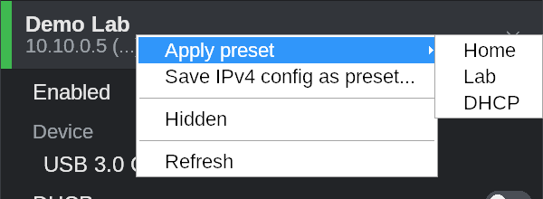
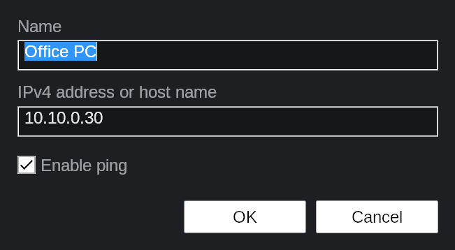
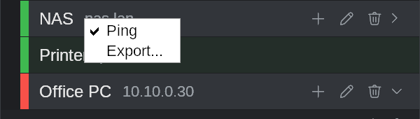
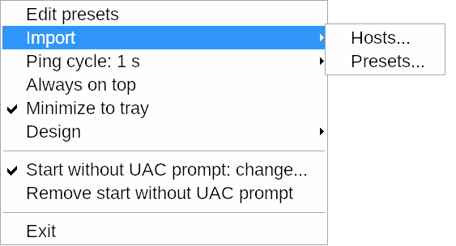
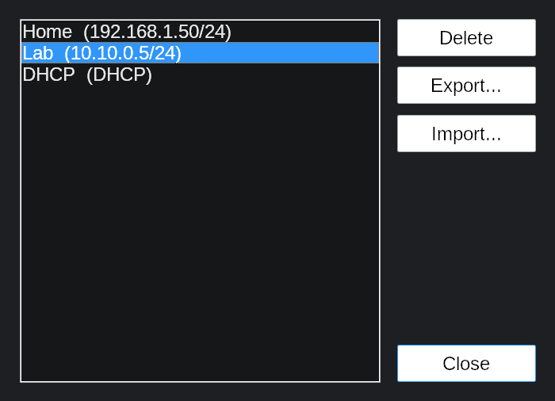

# NIC Manager

> This app was coded with Claude Opus (Anthropic) in Claude Code.

A small, fast tray tool for Windows 10/11 that switches network adapter IPv4
settings, keeps IPv4 presets, watches a list of hosts with ping and connects to
them with RDP, SSH, VNC or the browser in one click. It also scans a subnet
for hosts (ARP, ping or a TCP port), without extra tools.

Plain C++17 on the Win32 API: one ~2.5 MB executable for 64 or 32 bit, no
framework, no runtime to install, no third-party libraries.

<p>
  
</p>

## Features

The screenshots were taken with `--demo` (sample adapters, nothing is changed).

### Adapters

<p>
  
</p>

- Every adapter with name, address and state: green connected, red disconnected, grey disabled.
- Click an adapter to expand it. Switch it on or off, turn DHCP and Auto DNS on or off.
- Add, edit (also by double-click) and remove IP addresses, DNS servers and gateways inline. An adapter can have several addresses.
- Wi-Fi adapters get a button that opens the Windows Wi-Fi picker.

**Right-click menu**

<p>
  
</p>

- **Apply preset**: sets the adapter to a saved IPv4 configuration.
- **Save IPv4 config as preset...**: stores the current configuration under a name.
- **Hidden**: leaves the adapter out of the list (the eye button in the bottom bar shows it again).
- **Refresh**: reads all adapters again.

### Hosts

<p>
  
</p>

- A ping list with live state: green reachable, red not reachable, grey ping off. The tooltip shows the round-trip time.
- Each host can have actions, started with one click on ▶:
  - **RDP** with the stored, encrypted password (temporary `.rdp` file).
  - **SSH** in a console window with the Windows OpenSSH client.
  - **VNC** with the TightVNC viewer.
  - **Browser** with the default browser.
- Groups: fold and unfold them, add hosts with the group's +, and drag hosts between groups and the top level. A group with ping off turns ping off for all its hosts.
- Removing a group asks whether its hosts are removed too or move to the top level.
- Passwords are encrypted with Windows DPAPI: only your Windows account on this PC can read them.

<p>
  
  &nbsp;
  
</p>

**Right-click menu**

<p>
  
</p>

- On a host or group: **Ping** switches pinging on or off, **Export...** saves it as JSON (a group with its hosts).
- On the HOSTS header: **Export...** saves all hosts and groups.
- Tray menu **Import > Hosts...** reads such a file back. Entries with the same name are replaced by the file's.

### Subnet scan

<p>
  
</p>

- The magnifier next to an IP address scans its subnet (/24 or smaller): ARP, ping or a TCP port.
- Built in: no nmap, no Npcap, no administrator rights.
- The bottom bar shows the progress. The magnifier turns into X while the scan runs; stopping keeps the hosts found so far.

<p>
  
</p>

- The result shows address, name, MAC and vendor (from the [IEEE OUI registry](https://standards-oui.ieee.org/), embedded in the exe). Entries can be copied or added to the ping list.

<p>
  
</p>

### Tray menu

<p>
  
</p>

- A left click on the tray icon shows or hides the window.
- **Edit presets**: the saved IPv4 presets, with delete, export (the selected ones, or all) and import.
- **Import**: hosts or presets from a JSON file.
- **Ping cycle**: 0.5 s to 30 s, or a custom value from 0.1 s.
- **Always on top**, **Minimize to tray** (without it the window also has a taskbar button). The window stays inside the screen and snaps to its edges.
- **Design**: Standard or Color-blind friendly (blue/orange instead of green/red).
- **Start without UAC prompt**: registers a scheduled task that starts NIC Manager elevated without the prompt, optionally at logon and with a desktop shortcut.
- **Trust signing certificate** (signed builds only): shows NIC Manager as verified publisher.

<p>
  
</p>

### Icons

| | |
|---|---|
|  | Add a host, an address, a DNS server, a gateway or an action |
|  | Add a host group |
|  | Edit |
|  | Remove |
|  | Run the action |
|  | Scan the subnet |
|  | Choose a Wi-Fi network |
|  | Host group |
|  | Expand or collapse |
|  | Bottom bar: open Network Connections (ncpa.cpl) |
|  | Bottom bar: flush the DNS cache |
|  | Bottom bar: renew the DHCP lease (expanded adapter, or all) |
|  | Bottom bar: show or leave out hidden adapters |

### Rights

NIC Manager checks its rights at start:

- **Administrator** (your own account, elevated): everything.
- **Elevated as another account** (Intune Endpoint Privilege Management, "Run as administrator" with someone else's credentials): everything except the start task. Settings then come from that account's registry.
- **Standard user**: adapter settings are read-only. Hosts, ping, actions, scans, flushing DNS, presets and import/export work.

Errors show in a strip at the bottom that hides itself after 5 seconds; their details can be copied.

## Download

Ready-built executables for x64 and x86 are attached to each
[release](../../releases). Run `NicManager.exe`; administrators get the UAC
prompt, because changing adapter settings needs elevation. Standard users
start without a prompt in read-only mode, or use "Run as administrator".

## Building from source on Windows

### 1. Prerequisites

| What | Why | Install |
|---|---|---|
| Git for Windows | get the source (optional, see below) | `winget install Git.Git` |
| MSYS2 | GCC, CMake and Ninja (MinGW-w64) | `winget install MSYS2.MSYS2` (installs to `C:\msys64`) |
| VS Code + C/C++ and CMake Tools extensions | optional IDE | `winget install Microsoft.VisualStudioCode` |

After installing MSYS2, open **MSYS2 UCRT64** from the Start menu and install
the toolchain:

```sh
# 64-bit build
pacman -S --needed mingw-w64-ucrt-x86_64-gcc mingw-w64-ucrt-x86_64-cmake mingw-w64-ucrt-x86_64-ninja

# 32-bit build (optional)
pacman -S --needed mingw-w64-i686-gcc mingw-w64-i686-cmake mingw-w64-i686-ninja
```

The CMake presets expect MSYS2 in `C:\msys64`. If yours is elsewhere, adjust
the paths in `CMakePresets.json`.

### 2. Get the source

With Git:

```bat
git clone https://github.com/<your-account>/nic-manager.git
cd nic-manager
```

Without Git: on the GitHub page choose **Code → Download ZIP**, unpack it, or
just copy the project folder to the machine. Open a terminal in that folder.

### 3. Build

From a normal Command Prompt or PowerShell in the project folder:

```bat
cmake --preset mingw-x64-release
cmake --build --preset mingw-x64-release
```

The executable is `build\mingw-x64-release\NicManager.exe`.

| Preset | Result |
|---|---|
| `mingw-x64-release` | 64-bit release |
| `mingw-x64-debug` | 64-bit debug build |
| `mingw-x64-noadmin` | 64-bit debug build that does not ask for elevation (UI work only) |
| `mingw-x86-release` | 32-bit release (needs the `mingw-w64-i686-*` packages) |
| `msvc-x64` / `msvc-x86` | Visual Studio 2022 builds (not tested) |

Alternatively, inside the **MSYS2 UCRT64** shell:

```sh
cmake -S . -B build -G Ninja -DCMAKE_BUILD_TYPE=Release
cmake --build build
```

To set the version shown in the file properties, add `-DNICMGR_VERSION=1.2.0.0`.

**VS Code:** open the folder, choose the preset `mingw-x64-debug` in the CMake
status bar, and press F7 to build or F5 to debug.

### 4. Run

```bat
build\mingw-x64-release\NicManager.exe
build\mingw-x64-release\NicManager.exe --demo
```

`--demo` shows sample adapters and simulates all commands, which is handy for
trying the UI without administrator rights or real changes.

### Optional: code signing

With a self-signed certificate the exe carries a signature, and the tray menu
item "Trust signing certificate" installs that certificate on a PC, so Windows
shows the publisher in the UAC prompt.

1. `powershell -ExecutionPolicy Bypass -File tools\make-cert.ps1` creates
   `signing\nicmanager.pfx` (private, never committed) and `res\nicmanager.cer`
   (public, embedded in the exe).
2. Install a signing tool: `pacman -S mingw-w64-ucrt-x86_64-osslsigncode`, or use `signtool` from the Windows SDK.
3. Set the password and build. The exe is signed after linking:
   ```bat
   set NICMGR_SIGN_PASSWORD=your-password
   cmake --build --preset mingw-x64-release
   ```

### Releases with GitHub Actions

Pushing a tag such as `v1.2.0.0` builds x64 and x86 and publishes a GitHub
release (`.github/workflows/release.yml`). If the repository secrets
`SIGNING_PFX_BASE64` (the .pfx as Base64) and `SIGNING_PFX_PASSWORD` are set,
the release executables are signed.

```bat
git tag v1.2.0.0
git push origin v1.2.0.0
```

## Settings

Everything is stored per user in the registry under
`HKCU\Software\NicManager` (window position, options, hosts, presets).
Passwords are encrypted with DPAPI. Remove that key to reset the app.

## Optional tools

| Tool | Used for |
|---|---|
| Windows OpenSSH client (built into Windows 10/11, version 8.4 or later) | SSH actions |
| [TightVNC viewer](https://www.tightvnc.com/) | VNC actions; set its path in the VNC action dialog |

## Project layout

| Path | Content |
|---|---|
| `src/` | the application (window, adapters, commands, ping, actions, subnet scan, settings) |
| `res/` | dialogs, manifest, icon, MAC vendor table (`oui.bin`) |
| `cmake/`, `tools/` | signing step, certificate, icon and vendor table scripts |
| `docs/` | [design notes](docs/PLAN.md) and screenshots |

## License

[MIT](LICENSE)
