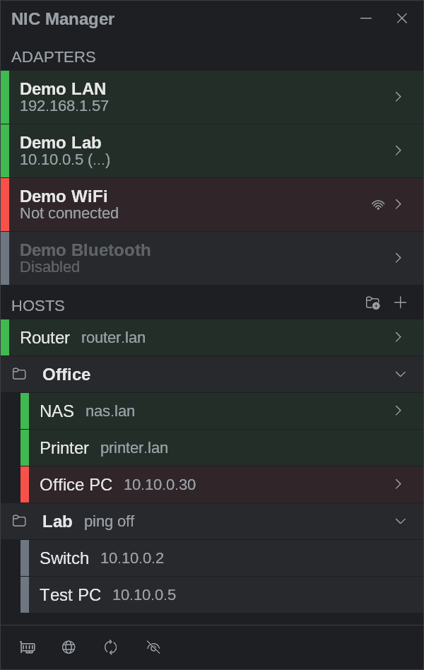
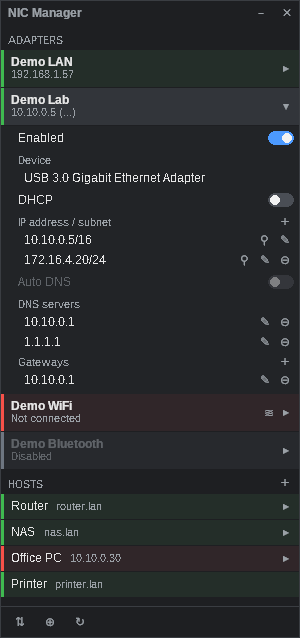
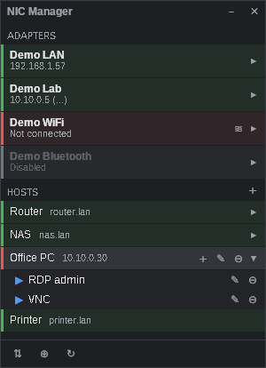
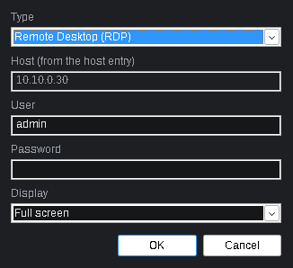
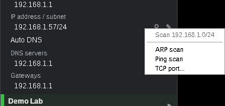
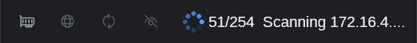
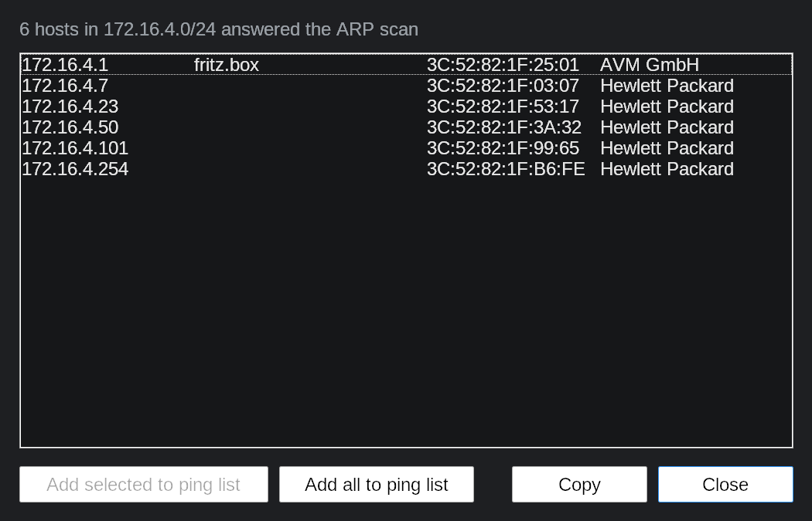

# NIC Manager

> This app was coded with Claude Opus (Anthropic) in Claude Code.

A small, fast tray tool for Windows 10/11 that switches network adapter IPv4
settings, keeps IPv4 presets, watches a list of hosts with ping and connects to
them with RDP, SSH, VNC or the browser in one click. It also scans a subnet
for hosts (ARP, ping or a TCP port), without extra tools.

Plain C++17 on the Win32 API: one ~2.5 MB executable for 64 or 32 bit, no
framework, no runtime to install, no third-party libraries.

<p>
  
  &nbsp;
  
</p>

## Features

**Adapters**
- See every adapter at a glance: name, address and state (connected, disconnected, disabled).
- Enable or disable an adapter, switch DHCP on or off, and edit IP addresses (several per adapter), gateways and DNS servers inline.
- Save an adapter's configuration as a preset and apply it to any adapter later. Presets can be exported to and imported from JSON.
- Flush the DNS cache, renew DHCP leases, open the classic Network Connections window, and open the Windows Wi-Fi picker from a Wi-Fi adapter.

**Hosts**
- A ping list with names and live state (green: reachable, red: not reachable, with round-trip time in the tooltip). The ping cycle is adjustable from 0.1 s to 30 s, and pinging can be turned off per host in its edit dialog or its right-click menu (the marker then stays grey).
- Optional groups (folder button next to +): fold and unfold them, add hosts with the group's +, drag hosts between groups and the top level. A group's ping switch applies on top of each host's own; removing a group asks whether its hosts go with it or move to the top level.
- Actions per host, started with one click:
  - **RDP** with a temporary `.rdp` file that holds the encrypted password (only clipboard redirection).
  - **SSH** in a console window with the Windows OpenSSH client, logged in with the stored password.
  - **VNC** with the TightVNC viewer.
  - **Browser** with the default browser.
- Passwords are encrypted with Windows DPAPI, so only your Windows account on this PC can decrypt them.

<p>
  
  &nbsp;
  
</p>

**Subnet scan**
- Each IP address has a scan button that offers an ARP scan, a ping scan or a TCP port check of its subnet (/24 or smaller). It is built in: no nmap, no Npcap, no administrator rights needed.
- Addresses are probed in parallel and the bottom bar shows the progress. The button turns into X while a scan runs, so you can stop it and still get the hosts found so far.
- The result list is sorted by address and shows name (reverse DNS / NetBIOS), MAC and vendor (from the [IEEE OUI registry](https://standards-oui.ieee.org/), embedded in the exe). You can copy entries or add them to the ping list.

<p>
  
</p>
<p>
  
</p>
<p>
  
</p>

**Window and tray**
- Lives in the tray. "Minimize to tray" decides whether it also has a taskbar button.
- Stays inside the screen and snaps to its edges. It can stay always on top.
- Errors show in a strip at the bottom that hides itself after 5 seconds; their details can be copied.
- **Start without UAC prompt:** changing adapters needs administrator rights. NIC Manager can register a scheduled task that starts it elevated without the prompt, optionally at logon (minimized) and with a desktop shortcut.

The screenshots were taken with `--demo` (sample adapters, nothing is changed).

## Download

Ready-built executables for x64 and x86 are attached to each
[release](../../releases). Run `NicManager.exe`; it asks for administrator
rights because changing adapter settings needs them.

## Building from source on Windows

### 1. Prerequisites

| What | Why | Install |
|---|---|---|
| Git for Windows | get the source (optional, see below) | `winget install Git.Git` |
| MSYS2 | GCC, CMake and Ninja (MinGW-w64) | `winget install MSYS2.MSYS2` (installs to `C:\msys64`) |
| VS Code + C/C++ and CMake Tools extensions | optional IDE | `winget install Microsoft.VisualStudioCode` |

After installing MSYS2, open **MSYS2 UCRT64** from the Start menu and install
the toolchain:

```sh
# 64-bit build
pacman -S --needed mingw-w64-ucrt-x86_64-gcc mingw-w64-ucrt-x86_64-cmake mingw-w64-ucrt-x86_64-ninja

# 32-bit build (optional)
pacman -S --needed mingw-w64-i686-gcc mingw-w64-i686-cmake mingw-w64-i686-ninja
```

The CMake presets expect MSYS2 in `C:\msys64`. If yours is elsewhere, adjust
the paths in `CMakePresets.json`.

### 2. Get the source

With Git:

```bat
git clone https://github.com/<your-account>/nic-manager.git
cd nic-manager
```

Without Git: on the GitHub page choose **Code → Download ZIP**, unpack it, or
just copy the project folder to the machine. Open a terminal in that folder.

### 3. Build

From a normal Command Prompt or PowerShell in the project folder:

```bat
cmake --preset mingw-x64-release
cmake --build --preset mingw-x64-release
```

The executable is `build\mingw-x64-release\NicManager.exe`.

| Preset | Result |
|---|---|
| `mingw-x64-release` | 64-bit release |
| `mingw-x64-debug` | 64-bit debug build |
| `mingw-x64-noadmin` | 64-bit debug build that does not ask for elevation (UI work only) |
| `mingw-x86-release` | 32-bit release (needs the `mingw-w64-i686-*` packages) |
| `msvc-x64` / `msvc-x86` | Visual Studio 2022 builds (not tested) |

Alternatively, inside the **MSYS2 UCRT64** shell:

```sh
cmake -S . -B build -G Ninja -DCMAKE_BUILD_TYPE=Release
cmake --build build
```

To set the version shown in the file properties, add `-DNICMGR_VERSION=1.2.0.0`.

**VS Code:** open the folder, choose the preset `mingw-x64-debug` in the CMake
status bar, and press F7 to build or F5 to debug.

### 4. Run

```bat
build\mingw-x64-release\NicManager.exe
build\mingw-x64-release\NicManager.exe --demo
```

`--demo` shows sample adapters and simulates all commands, which is handy for
trying the UI without administrator rights or real changes.

### Optional: code signing

With a self-signed certificate the exe carries a signature, and the tray menu
item "Trust signing certificate" installs that certificate on a PC, so Windows
shows the publisher in the UAC prompt.

1. `powershell -ExecutionPolicy Bypass -File tools\make-cert.ps1` creates
   `signing\nicmanager.pfx` (private, never committed) and `res\nicmanager.cer`
   (public, embedded in the exe).
2. Install a signing tool: `pacman -S mingw-w64-ucrt-x86_64-osslsigncode`, or use `signtool` from the Windows SDK.
3. Set the password and build. The exe is signed after linking:
   ```bat
   set NICMGR_SIGN_PASSWORD=your-password
   cmake --build --preset mingw-x64-release
   ```

### Releases with GitHub Actions

Pushing a tag such as `v1.2.0.0` builds x64 and x86 and publishes a GitHub
release (`.github/workflows/release.yml`). If the repository secrets
`SIGNING_PFX_BASE64` (the .pfx as Base64) and `SIGNING_PFX_PASSWORD` are set,
the release executables are signed.

```bat
git tag v1.2.0.0
git push origin v1.2.0.0
```

## Settings

Everything is stored per user in the registry under
`HKCU\Software\NicManager` (window position, options, hosts, presets).
Passwords are encrypted with DPAPI. Remove that key to reset the app.

## Optional tools

| Tool | Used for |
|---|---|
| Windows OpenSSH client (built into Windows 10/11, version 8.4 or later) | SSH actions |
| [TightVNC viewer](https://www.tightvnc.com/) | VNC actions; set its path in the VNC action dialog |

## Project layout

| Path | Content |
|---|---|
| `src/` | the application (window, adapters, commands, ping, actions, subnet scan, settings) |
| `res/` | dialogs, manifest, icon, MAC vendor table (`oui.bin`) |
| `cmake/`, `tools/` | signing step, certificate, icon and vendor table scripts |
| `docs/` | [design notes](docs/PLAN.md) and screenshots |

## License

[MIT](LICENSE)
